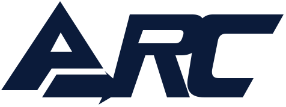
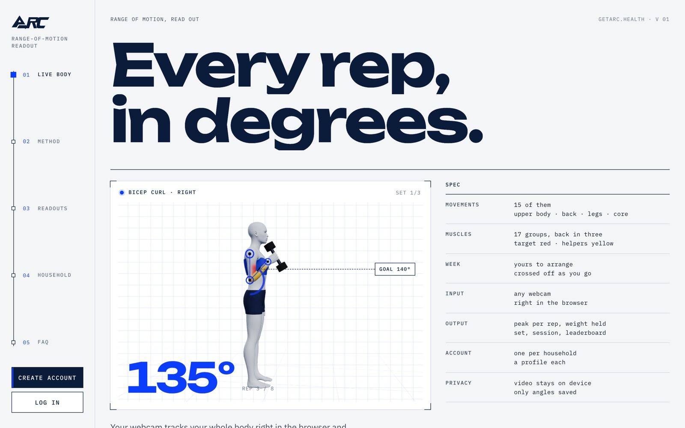
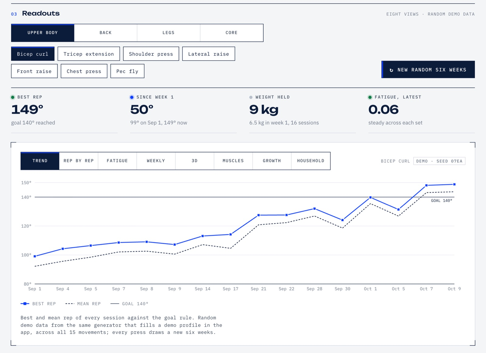
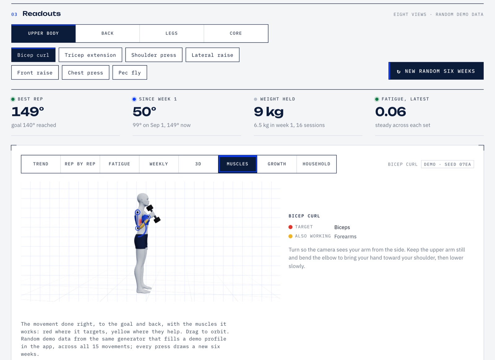
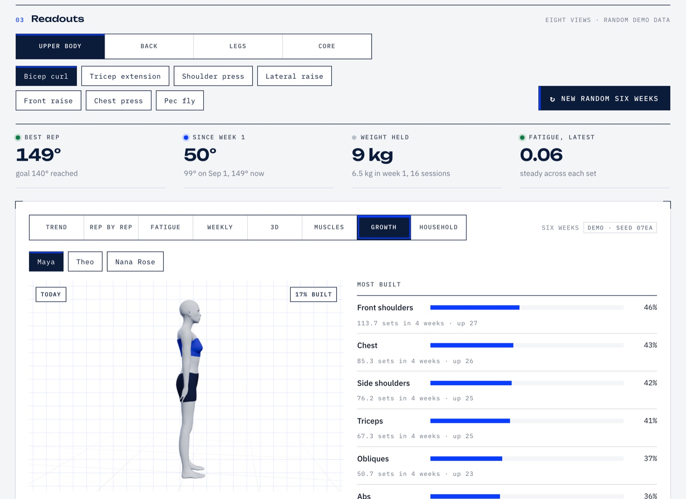
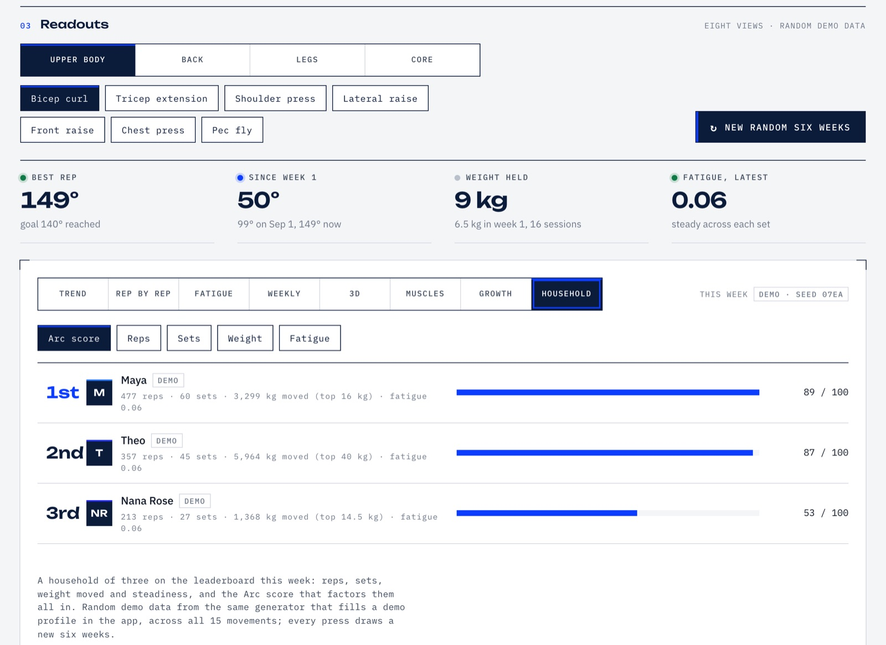
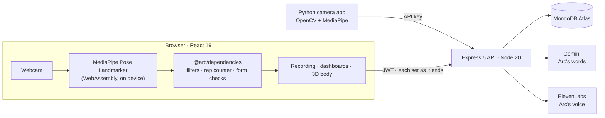

# Arc

<p></p>

**Every rep, in degrees.** Arc turns any webcam into a goniometer and a training coach. It tracks your body in the browser, measures each joint's range of motion in degrees, counts only the reps done with good form, and shows your progress over the weeks, including a 3D body that grows with the training you log.

Built in 48 hours at **Hackknight 2026**, over the weekend of October 9 to 11, 2026, by a team of three. Live at **[getarc.health](https://getarc.health)**.

[](https://github.com/swejasonzhang/Hackknight2026/actions/workflows/ci.yml)



> **Status:** the hackathon is over. This repository is a finished snapshot of what we built that weekend and is not under active development. The live site stays up while its hosting does.

## What it does

- **Tracks you through the webcam, in the browser.** MediaPipe pose tracking runs on your device. There is nothing to install, and the video never leaves your computer: only the angle of each rep is saved.
- **Measures 15 movements** across the upper body, back, legs and core, from bicep curls and lateral raises to squats, deadlifts and ab twists.
- **Counts only good reps.** Form checks catch a swinging upper arm, a bent arm on a raise or a rep that is too quick. The rep isn't counted, and the coach says why.
- **Coaches by voice.** Arc, the coach (Gemini for the words, ElevenLabs for the voice), builds your training week in a short onboarding chat, answers questions hands-free mid-set, and reads each set and session back in plain English.
- **Shows a body that grows.** A real 3D human shows each movement done right, with the muscles it trains painted on. The same figure fills out, muscle group by muscle group, with the sets you actually record.
- **Plans and tracks progress.** An editable training week, a daily checklist, multi-week challenges (such as "summer body in 12 weeks"), progress charts and a household leaderboard. One account covers a household, with a profile for each person.

Arc is a personal fitness tool, not a medical device.

## Screenshots

These are from the public landing page, which runs the app's own charts on randomly generated demo data.

| | |
|---|---|
|  |  |
| **Progress.** Best and mean rep of every session against the goal. | **Muscles.** The movement done right, target muscles in red, helpers in yellow. |
|  |  |
| **Growth.** The body as the training built it, week by week. | **Household.** Everyone at home ranked on reps, sets, weight moved and steadiness. |

## How it works



- **One engine, three consumers.** `@arc/dependencies` is plain TypeScript shared by the browser and the API: the exercise catalog, a One Euro filter, a hysteresis rep counter, the form checks, a fatigue proxy and session summaries. The Python camera app reads the same thresholds from a JSON catalog generated from that source, and a snapshot test fails CI if the two drift apart.
- **Steady numbers from a shaky camera.** Every landmark is smoothed with its own One Euro filter, and a frame the model is unsure of is bridged rather than trusted. Angles are read in 3D from MediaPipe's world landmarks, so a curl done facing the camera still reads true. For a movement done with both arms or legs, the tracker stays on the better-seen side until the other side is clearly better.
- **Nothing lost mid-workout.** Each set is written to MongoDB the moment it ends (one `POST`, then a `PUT` per set), so a closed tab or a dropped camera keeps every finished set. The server recomputes summaries and fatigue from the raw reps rather than trusting the client.
- **AI that degrades gracefully.** Gemini and ElevenLabs are called only from the server, with keys in headers. Without keys, every flow still works on Arc's own scripted questions, templated reads and the browser's built-in voice. The week Gemini writes is clamped to the member's training days, the catalog and the set and rep ranges for their training goal, and it is rejected if it trains the same body area two days running.
- **A real human body.** The figure is MakeHuman's CC0 mesh, baked at build time into a compact binary, skinned on the GPU to a 22-joint skeleton and posed for all 15 movements. Muscle growth is modelled per vertex from the sets each group received.
- **Performance, measured.** Pages are code-split by route, the 3D body ships gzipped, and the pose model loads only on the recording page. Profiling in GPU-enabled headless Chrome found 117 to 250 ms freezes whenever the exercise changed, because the 3D body was rebuilt each time. Mounting it once with shared materials removed them.

## Tech stack

| Layer | Tools |
|---|---|
| Frontend | React 19, TypeScript, Vite, Tailwind CSS 4, Motion, Radix UI, React Three Fiber and three.js, Recharts |
| Computer vision | MediaPipe Tasks Vision in the browser; OpenCV and MediaPipe in the Python app |
| Backend | Node 20, Express 5, Mongoose, zod, JWT and bcrypt |
| Database | MongoDB Atlas |
| AI and voice | Google Gemini, ElevenLabs, Web Speech API |
| Testing and CI | Vitest, Testing Library, supertest with an in-memory MongoDB, Python unittest, GitHub Actions |
| Hosting | Render (static site and web service), DNS at Porkbun |

## The weekend in numbers

| | |
|---|---|
| Time from first commit to last merge | 48 hours |
| Pull requests merged, each through CI | 44 |
| Automated tests | 600 (140 engine, 131 API, 299 web app, 30 Python) |
| TypeScript written | about 25,000 lines, a third of it tests |
| Architecture decision records | 34, in [docs/adr](docs/adr/) |
| Movements tracked / muscle groups modelled | 15 / 17 |

## Team

| Who | What they built |
|---|---|
| Jason Zhang ([@swejasonzhang](https://github.com/swejasonzhang)) | The web app and API: browser pose tracking, the rep and form engine, the 3D body, Arc's integration, the data model, CI and deployment |
| Kelvin ([@kekcodenoob](https://github.com/kekcodenoob)) | The Python camera app: OpenCV and MediaPipe tracking, the original exercise catalog, guiding arrows for form and pacing |
| Jerome White ([@Jaw718](https://github.com/Jaw718)) | The `ai-coach` module: the Gemini and ElevenLabs voice coach, the onboarding survey and the training-plan ranges that Arc's weeks are built within |

Jason built his part with Claude Code, an AI coding agent: he specified each feature, tested it by hand and merged every pull request through CI.

## Run it locally

You need Node 20.19 or newer and a MongoDB connection string (Atlas, or a local `mongod`).

```bash
git clone https://github.com/swejasonzhang/Hackknight2026.git arc && cd arc
npm install
cp .env.example .env   # set MONGODB_URI and JWT_SECRET; the Gemini and ElevenLabs keys are optional
npm run dev            # API on :8787, web app on :5173
npm test               # engine, API and web app suites
```

Open <http://localhost:5173>, create an account, and use **Load demo data** on the Profiles page to fill the dashboards with six weeks of sessions.

The full setup, every environment variable, the API reference, the Python camera app, deployment and troubleshooting are in **[docs/REFERENCE.md](docs/REFERENCE.md)**.

## Repository layout

```
dependencies/     shared TypeScript: exercise catalog, rep counter, filters, form checks, demo data, API schemas
backend/          Express 5 + Mongoose API, with tests against an in-memory MongoDB
frontend/         React app: pages, recording, the 3D body, plans, challenges, Arc's voice
computer-vision/  the Python camera app (OpenCV + MediaPipe)
ai-coach/         the original Python Gemini + ElevenLabs module, ported into the API
docs/             reference, architecture decision records, backlog and sprints
```

## What we learned

- **Take the riskiest dependency off the critical path.** The plan was for the web app to display sessions recorded by the Python camera app. That integration was our biggest risk, so on day two we moved pose tracking into the browser too. It removed the install step for users and meant the demo no longer depended on one laptop's Python setup.
- **Infrastructure fails in boring ways.** The API went down overnight because a temporary MongoDB Atlas IP rule expired, and the campus Wi-Fi blocked database traffic outright. The lasting fix was an API that starts without its database, reports the connection on `/api/health`, and reconnects by itself.
- **Measure before optimising.** The 3D figure "stuttered", and software-rendered screenshots could not show why. Profiling with the real GPU found the cause.
- **Breadth is not a demo.** We kept shipping features into the final hours. Next time we would freeze features earlier and spend that time rehearsing a tight three-minute demo.

## Known limitations

- The leaderboard compares the profiles in one household only. A global board would need an opt-in and public names first.
- Hands-free voice commands rely on the Web Speech API, so they work in Chrome and Edge only.
- One camera sees one side of the body: side-on framing and good light matter.
- There is no password reset or data export.
- The Python camera app counts reps at the same thresholds as the browser but does not run the form checks.

## Credits

The 3D body is built from [MakeHuman](http://www.makehumancommunity.org/) assets (CC0). Pose tracking is Google's [MediaPipe](https://ai.google.dev/edge/mediapipe). Type is Unbounded, IBM Plex Sans and IBM Plex Mono.
